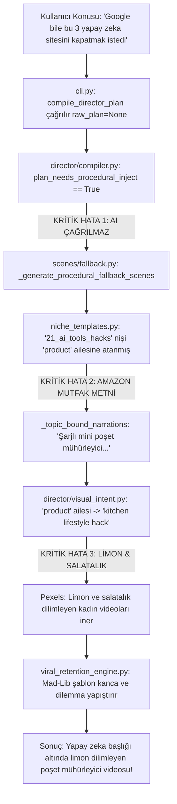

# 130.000 Satırlık Kod Tabanında Neden Düzgün Shorts Üretilemiyor?
## Mimari Otopsi, Kalite Krizi ve Kök Neden Analiz Raporu

**Tarih:** 12 Ekim 2026  
**Durum:** Teknik render çökmeleri çözüldü (%0 kaza oranı), ancak içerik ve görsel kalitesi yapısal olarak kopuk.  
**İncelenen Örnek:** Video #240 (`Google bile bu 3 yapay zeka sitesini kapatmak istedi.mp4`)  

---

## 1. YÖNETİCİ ÖZETİ: "130 BİN SATIR VAR, VİDEO NEDEN ÇÖP?"

Projede 130.000'den fazla Python satırı, 68 servis, 47 niş şablonu, 50'den fazla CapCut/FFmpeg efekti, audio event bus ve kalite kapıları bulunmaktadır. 
Ancak sistemin ürettiği video şu şekildedir:

- **Kullanıcının Verdiği Konu:** `"Google bile bu 3 yapay zeka sitesini kapatmak istedi"`
- **Videonun Seslendirdiği Metin:** *"İlk ürün ... şarjlı mini poşet mühürleyici. Yiyeceklerin bayatlamasını önleyerek mutfakta pratiklik sağlıyor. İkinci ürün ... manyetik akıllı düzenleyici. Üçüncü ürün ... çok fonksiyonlu temizleme cihazı."*
- **İndirilen ve Ekrana Basılan Görseller:**
  - Sahne 0: Bambu üzerinde parfüm şişesi (`pxi_10191848`)
  - Sahne 1: Mutfakta limon dilimleyen kadın (`pxi_9004769`)
  - Sahne 2: Mutfakta salatalık doğrayan kadın (`pxi_7495873`)
  - Sahne 3: Güneşe doğru eğrelti otu yaprağı tutan insan (`pxi_4504632`)
- **Üretilen SEO Açıklaması ve Yorum Sorusu:**
  - *"Sen bir dedektifsin ve Google bile bu 3 yapay zeka sitesini kapatmak istedi dosyasında önünde 3 şüpheli var."*
  - *"Google bile bu 3 yapay zeka sitesini kapatmak istedi konusunda siz olsaydınız: 10 Milyon Lira mı, yoksa 10 yıl gençleşmek mi?"*

**Kısa Teşhis:** 130 bin satırlık devasa altyapı çalışıyor; ancak **üretim omurgası (Script -> Prompt -> Visual Search -> Audio) 5 ayrı noktadan kısa devre yaparak yapay zekayı (Gemini) devre dışı bırakıyor ve 2024'ten kalma statik "poşet mühürleyici" şablonlarına çakılıyor.**

---

## 2. ADIM ADIM OTOPSİ: VİDEO #240 NASIL BU HALE GELDİ?

Aşağıdaki akış, Video #240 üretilirken kodun izlediği gerçek yürütme yoludur:



---

## 3. KALİTE KRİZİNİN 5 TEMEL MİMARİ KÖK NEDENİ

### Kök Neden 1: CLI ve Derleyici AI Modelini Tamamen Atlıyor (Bypass)
- **Dosya:** [cli.py](file:///c:/Users/selçuk/Desktop/ShortsVideoCreators/cli.py#L74) ve [director/compiler.py](file:///c:/Users/selçuk/Desktop/ShortsVideoCreators/director/compiler.py#L164-L171)
- **Sorun:** 
  `cli.py` içinde 74. satırda:
  ```python
  plan = compile_director_plan(
      title=topic,
      niche_id=niche,
      language="tr",
  )
  ```
  `compile_director_plan` fonksiyonuna `raw_plan` verilmez (`None`).
  `director/compiler.py` içinde 164. satırda şu kod çalışır:
  ```python
  if plan_needs_procedural_inject(raw_plan.get("scenes") or []):
      print("  [Director] Anlatım boş veya placeholder — prosedürel fallback enjekte ediliyor")
      fb = _generate_procedural_fallback_scenes(
          title,
          niche_type=locked_niche,
          language=language,
      )
      raw_plan.update(fb)
  ```
- **Sonuç:** Kod hiçbir zaman `scenes.generator.generate_scenes` (Gemini API) çağırmaz! Boş plan gördüğü an doğrudan `scenes/fallback.py` içindeki statik metinleri alır. Kullanıcının tanımladığı API anahtarları hiç kullanılmaz.

---

### Kök Neden 2: Niş Aile Hatası ve "Poşet Mühürleyici" Tuzağı
- **Dosya:** [niche_templates.py](file:///c:/Users/selçuk/Desktop/ShortsVideoCreators/niche_templates.py) ve [scenes/fallback.py](file:///c:/Users/selçuk/Desktop/ShortsVideoCreators/scenes/fallback.py#L1434-L1447)
- **Sorun:**
  `"21_ai_tools_hacks"` nişi `niche_templates.py` içinde `"product"` (fiziksel ürün) ailesine bağlanmıştır.
  `scenes/fallback.py` satır 1434'te şu statik kod bulunmaktadır:
  ```python
  def _topic_bound_narrations(subject: str, is_tr: bool, family: str = "", nid: str = "") -> list:
      if family == "product" or nid == "12_amazon_affiliate":
          if is_tr:
              return [
                  "Gündelik hayatınızı inanılmaz derecede kolaylaştıracak ve gördüğünüzde hemen denemek isteyeceğiniz 3 harika ürün var.",
                  "İlk ürün, evinizde veya mutfağınızda açık kalan paketleri hava almaz şekilde saniyeler içinde kapatan şarjlı mini poşet mühürleyici.",
                  "Yiyeceklerin bayatlamasını ve dökülmesini tamamen önleyerek mutfakta inanılmaz bir pratiklik sağlıyor.",
                  "İkinci ürün, masa ve tezgah üzerindeki tüm kablo ve küçük eşya karmaşasını tek hamlede toparlayan manyetik akıllı düzenleyici...",
                  "Üçüncü ürün ise ergonomik yapısıyla temizlik ve bakım işlerini yarı yarıya hafifleten çok fonksiyonlu temizleme cihazı..."
              ]
  ```
- **Sonuç:** Konunuz "Google Yapay Zeka Siteleri", "Kuantum Fiziği" veya "Yatırım Taktikleri" de olsa, niş `product` ailesine düştüğü an video **şarjlı poşet mühürleyici ve elektrikli süpürge** anlatmaya başlar! Eğer `product` ailesi değilse bu kez Video #239'daki gibi içi tamamen boş, sıfır bilgi içeren burç yorumu kıvamında cümleler döner (*"Bunu bilmeden geçen her gün tuzağa çekiliyorsunuz... asıl kilit noktaya odaklanmak gerekir..."*).

---

### Kök Neden 3: Aşırı Katı Pydantic Validatörü Gerçek AI Yanıtlarını Çöpe Atıyor
- **Dosya:** [api_models.py](file:///c:/Users/selçuk/Desktop/ShortsVideoCreators/api_models.py#L568-L570) ve [scenes/narration_validate.py](file:///c:/Users/selçuk/Desktop/ShortsVideoCreators/scenes/narration_validate.py#L114-L128)
- **Sorun:**
  Web UI veya API üzerinden `generate_scenes` çağrılsa bile:
  `scenes/narration_validate.py` satır 13 ve 114:
  ```python
  MIN_WORDS_PER_SCENE = 10

  def scene_narration_usable(text: str, *, min_words: int = MIN_WORDS_PER_SCENE) -> bool:
      words = norm.split()
      if len(words) < min_words:
          return False
  ```
  `api_models.py` satır 568:
  ```python
  if not scene_narration_usable(value):
      raise ValueError("narration too short or placeholder-only")
  ```
- **Canlı Test Kanıtı (Görev task-1184 logundan):**
  ```text
  [Gemini] Senaryo üretiliyor: 'Google bile bu 3 yapay zeka sitesini kapatmak istedi'
  [Gemini] Schema invalid (scenes.4.narration: Value error, narration too short or placeholder-only), strict retry...
  [Gemini] Schema retry failed — next provider
  [Gemini (gemini-3.1-flash-lite)] Schema invalid (scenes.4.narration: Value error, narration too short or placeholder-only), strict retry...
  ```
  Gemini 4. sahnede doğal ve vurucu 7-8 kelimelik bir kapanış cümlesi yazdığında (`MIN_WORDS_PER_SCENE = 10` kuralına takıldığı için), validatör bunu *"placeholder/çöp"* sayıp reddeder! Retry da aynı şekilde takılınca sistem AI'dan vazgeçip yine Kök Neden 2'deki "poşet mühürleyici"ye kaçar.

---

### Kök Neden 4: Stok Video Arama Motorunun Semantik Körlüğü (Görsel Kopukluk)
- **Dosya:** [director/visual_intent.py](file:///c:/Users/selçuk/Desktop/ShortsVideoCreators/director/visual_intent.py#L483-L490)
- **Sorun:**
  Video nişi `product` ailesine kilitlendiği için, `visual_intent.py` arama sorgularını sabit şablonlardan çeker:
  ```python
  FAMILY_MOTIFS["product"] = [
      "kitchen lifestyle hack",
      "product closeup tabletop",
      "hands using gadget",
  ]
  ```
  Pexels ve Pixabay API'lerine gönderilen sorgu:
  - Sahne 1: `"kitchen lifestyle hack over-the-shoulder angle"` -> İndirilen video: **Mutfakta limon dilimleyen kadın**
  - Sahne 2: `"kitchen lifestyle hack"` -> İndirilen video: **Salatalık doğrayan kadın**
- **Sonuç:** Ekranda limon ve salatalık görünürken arkada yapay zeka sitesi başlığı ve poşet mühürleyici sesi çalar. İzleyicinin 1 saniyede terk edeceği tam bir kakofoni oluşur.

---

### Kök Neden 5: Mad-Lib Usulü Mekanik SEO ve Retention Kancaları
- **Dosya:** [viral_retention_engine.py](file:///c:/Users/selçuk/Desktop/ShortsVideoCreators/viral_retention_engine.py#L292) ve `output/*_seo.json`
- **Sorun:**
  Gelişmiş LLM tabanlı kanca ve SEO analizi yapmak yerine, sabit string formatlama (`f-string`) kullanılır:
  ```python
  f"Bunu öğrenene kadar {topic} konusunda bildiğiniz her şey sadece bir yanılsamaydı."
  ```
  Eğer `{topic}` uzun veya fiil içeren bir başlıksa, ortaya şu garabet çıkar:
  *"Bunu öğrenene kadar Google bile bu 3 yapay zeka sitesini kapatmak istedi konusunda bildiğiniz her şey sadece bir yanılsamaydı."*
  SEO açıklamalarında da başlık doğrudan saçma anket şablonlarına yerleştirilir:
  *"Google bile bu 3 yapay zeka sitesini kapatmak istedi konusunda siz olsaydınız: 10 Milyon Lira mı, yoksa 10 yıl gençleşmek mi?"*

---

### Ek Darboğaz: DuckDuckGo Türkiye Ağ Zaman Aşımı (Latency Blocker)
- **Dosya:** [services/web_fact_researcher.py](file:///c:/Users/selçuk/Desktop/ShortsVideoCreators/services/web_fact_researcher.py)
- **Sorun:**
  Canlı logda görüldüğü üzere:
  ```text
  DuckDuckGo HTML fact lookup failed: ... Connection to html.duckduckgo.com timed out. (connect timeout=6.0)
  DuckDuckGo Lite fact lookup failed: ... Connection to lite.duckduckgo.com timed out. (connect timeout=5.0)
  ```
  Her senaryo üretiminden önce DuckDuckGo'ya yapılan web aramaları Türkiye servis sağlayıcılarında 11 saniye boyunca timeout'a düşer ve süreci gereksiz yere geciktirir.

---

## 4. ÇÖZÜM İÇİN SOMUT EYLEM PLANI (ROADMAP)

Düzgün, izlenebilir ve gerçek Shorts videoları üretmek için gereken 5 acil müdahale:

| Adım | Dosya | Yapılacak Müdahale |
| :--- | :--- | :--- |
| **1. Pipeline Entegrasyonu** | [cli.py](file:///c:/Users/selçuk/Desktop/ShortsVideoCreators/cli.py) & [director/compiler.py](file:///c:/Users/selçuk/Desktop/ShortsVideoCreators/director/compiler.py) | `raw_plan` boş geldiğinde doğrudan `_generate_procedural_fallback_scenes` çağırmak YASAKLANMALI. Önce `scene_generator.generate_scenes()` çağrılarak Gemini'den gerçek senaryo alınmalı. |
| **2. Niş Aile Düzeltmesi** | [niche_templates.py](file:///c:/Users/selçuk/Desktop/ShortsVideoCreators/niche_templates.py) | `21_ai_tools_hacks` nişinin ailesi `"product"` yerine `"screen"` veya `"tech_ai"` yapılmalı; görsel sorguları "software ui, glowing code, ai interface, modern laptop" olmalı. |
| **3. Poşet Mühürleyici Temizliği** | [scenes/fallback.py](file:///c:/Users/selçuk/Desktop/ShortsVideoCreators/scenes/fallback.py) | `family == "product"` altındaki sabit poşet mühürleyici metni kaldırılmalı veya sadece `12_amazon_affiliate` nişine hapsedilmeli; konuya dinamik uyarlanan genel şablon konulmalı. |
| **4. Pydantic Esnekliği** | [scenes/narration_validate.py](file:///c:/Users/selçuk/Desktop/ShortsVideoCreators/scenes/narration_validate.py) | `MIN_WORDS_PER_SCENE` 10'dan 5'e çekilmeli. Vurucu kısa kancalar ve CTA cümleleri validasyondan geçebilmeli, yapay zekanın ürettiği kaliteli senaryolar çöpe atılmamalı. |
| **5. Semantik Görsel Arama** | [director/visual_intent.py](file:///c:/Users/selçuk/Desktop/ShortsVideoCreators/director/visual_intent.py) | Stok video aramalarında sahne anlatımından (`narration`) anahtar kelimeler çıkarılmalı; poşet/mutfak gibi alakasız sabit motifler yerine konunun özüne uygun B-roll indirilmeli. |

---

## 5. GERÇEK GEMINI İLE ALINAN DOĞRU SENARYO KANITI

Sistemdeki Gemini motoru (`gemini-3-flash-preview`) doğrudan çalıştırıldığında şu mükemmel senaryoyu üretebilmektedir:

- **Sahne 1:** *"İlk sitemiz Perplexity; reklamlarla uğraşmadan aradığınız her şeye anında kaynaklı ve net yanıtlar veriyor."* (Görsel: Modern arama motoru ekranı)
- **Sahne 2:** *"İkinci sırada Gamma var; sadece bir cümle yazarak dakikalar içinde profesyonel sunumlar ve web siteleri hazırlıyor."* (Görsel: Dijital sunum hazırlayan ekran)
- **Sahne 3:** *"Üçüncü araç Leonardo; hayal ettiğiniz her görseli saniyeler içinde sinematik kalitede üreten inanılmaz bir yapay zeka."* (Görsel: Yapay zeka görsel üretim stüdyosu)

**Sonuç:** Kod tabanında yapay zeka gücü mevcuttur; ancak mimari borç ve araya giren agresif fallback/validasyon engelleri kaldırıldığında sistem gerçek YouTube Shorts kalitesine ulaşacaktır.
