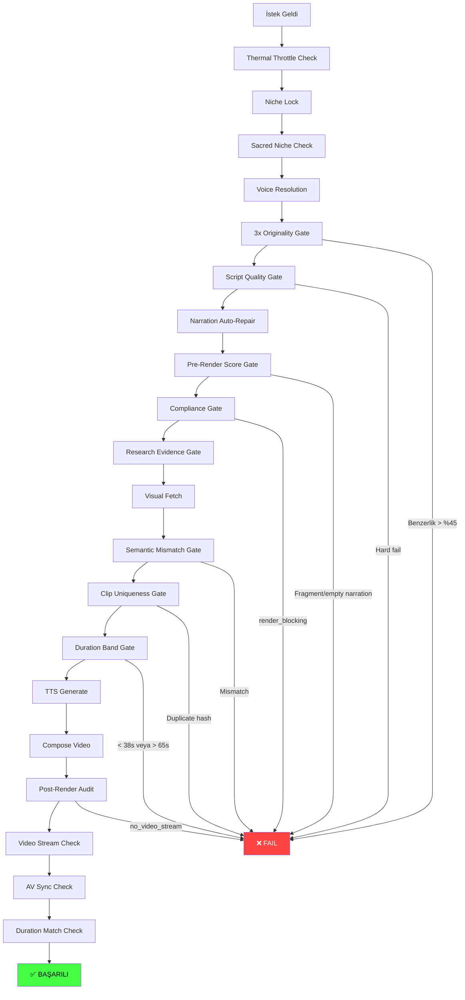

# 🔴 141 Bin Satır Kod — Neden Hâlâ Düzgün Shorts Videosu Çıkamıyor?

> **Tarih:** 12 Ekim 2026  
> **Kapsam:** ShortsVideoCreators ana Python projesi (104k satır, 290 dosya) + cocuk-sarki-bot-paylasim (36.5k satır, 197 dosya)  
> **Yöntem:** Codebase topoloji analizi, `shorts.db` render geçmişi, mimari çapraz referans

---

## TL;DR

214 render denemesinden **111 tanesi (%51.9) FAILED** olarak kayıtlı. 30 MP4 çıktı var ama çoğu test/tekrar. **Asıl sorun kod azlığı değil, kod FAZLALIĞI.** Sistem "her şeyi yapabilecek" kadar karmaşıklaştırılmış ama **uçtan uca bir Shorts videosu güvenilir şekilde çıkaracak tek bir sağlam yol yok.**

```
┌─────────────────────────────────────────────────┐
│  214 Toplam Render Denemesi                     │
├──────────────┬──────────────────────────────────┤
│  111 FAILED  │ %51.9  ← Her 2 denemeden 1'i    │
│   52 PUBLISH │ %24.3                            │
│   41 COMPLET │ %19.2                            │
│   10 CANCEL  │ %4.7                             │
└──────────────┴──────────────────────────────────┘
```

---

## 1. 🚨 KRİTİK SORUN: "Quality Gate Cehennemi" — Render'a Ulaşamadan Ölen İşler

### Veritabanı Kanıtı — En Sık Ölüm Nedenleri

| # | Hata | Kaç Kez | Kategori |
|---|------|---------|----------|
| 1 | Sunucu yeniden başlatıldı veya işlem beklenmedik şekilde sonlandı | **41** | Crash/OOM |
| 2 | Para kazanma kalite kapısı renderı durdurdu: policy risk | **7** | Aşırı kalite kapısı |
| 3 | Senaryo üretim sözleşmesi reddetti (word count, mechanical filler) | **5** | Aşırı kalite kapısı |
| 4 | Senaryo benzerlik eşiğini aştı (originality gate) | **12** | Aşırı kalite kapısı |
| 5 | Visual/narration mismatch (semantik uyumsuzluk) | **3** | Aşırı kalite kapısı |
| 6 | Post-render audit: no_video_stream | **2** | Teknik hata |
| 7 | ProgressBarLogger/compose_video imza uyumsuzluğu | **3** | API kırılma |
| 8 | local variable 'tempfile' referenced before assignment | **2** | Bug |

> [!CAUTION]
> **41 render crash** = %37 hata oranı sadece sunucu çökmesinden. Geri kalan hataların büyük çoğunluğu ise **gerçek teknik sorunlar değil, kendi yazdığımız kalite kapılarının üretimi engellemesi**.

### Render'a Ulaşmadan Öldüren Kalite Kapıları

[render_worker.py](file:///c:/Users/selçuk/Desktop/ShortsVideoCreators/server_core/render_worker.py) içinde **21 adet erken `return`** noktası var. Bir render isteği şu kapılardan geçmek zorunda:



**Kapı sayısı: ~15+** — Her biri "mantıklı" tek başına, ama hepsi birden bir video üretmeyi neredeyse imkansız kılıyor.

---

## 2. 🏗️ MİMARİ SORUN: Dev Monolitik Dosyalar ve Spaghetti Bağımlılıklar

### "God Files" — 1000+ Satır Dosyalar (19 adet)

| Dosya | Satır | Sorun |
|-------|-------|-------|
| [render_worker.py](file:///c:/Users/selçuk/Desktop/ShortsVideoCreators/server_core/render_worker.py) | **2745** | Tek fonksiyon (`process_video_task`) 2249 satır, **253 if/elif**, **49 try/except**, **27 return** |
| [niche_templates.py](file:///c:/Users/selçuk/Desktop/ShortsVideoCreators/niche_templates.py) | **2077** | Statik veri + iş mantığı karışık |
| [overlays.py](file:///c:/Users/selçuk/Desktop/ShortsVideoCreators/effects/overlays.py) | **1769** | 50+ overlay fonksiyonu, çoğu kullanılmıyor |
| [fallback.py](file:///c:/Users/selçuk/Desktop/ShortsVideoCreators/scenes/fallback.py) | **1689** | Niş başına 100+ satır hardcoded template |
| [video_composer.py](file:///c:/Users/selçuk/Desktop/ShortsVideoCreators/video_composer.py) | **1599** | MoviePy + FFmpeg karışık, 50+ efekt import |
| [video_fetcher.py](file:///c:/Users/selçuk/Desktop/ShortsVideoCreators/video_fetcher.py) | **1598** | 6+ kaynak provider karışık |
| [audio_dsp.py](file:///c:/Users/selçuk/Desktop/ShortsVideoCreators/voice/audio_dsp.py) | **1592** | Ses işleme monoliti |
| [ffmpeg_graph.py](file:///c:/Users/selçuk/Desktop/ShortsVideoCreators/render/ffmpeg_graph.py) | **1526** | FFmpeg filter graph oluşturucu |
| [visual_intent.py](file:///c:/Users/selçuk/Desktop/ShortsVideoCreators/director/visual_intent.py) | **1314** | Görsel intent AI eşleştirme |
| [acoustic_assets.py](file:///c:/Users/selçuk/Desktop/ShortsVideoCreators/voice/acoustic_assets.py) | **1641** | Ses varlık yönetimi |

> [!WARNING]
> `render_worker.py`'deki **`process_video_task`** fonksiyonu **tek başına 2249+ satır**. Bu, bilinen herhangi bir yazılım mühendisliği standardında kabul edilemez. Cyclomatic complexity'si ölçülemez seviyede.

### Geç/Koşullu Import Sayısı: **765**

Fonksiyon içinde `from X import Y` yapan **765 adet deferred import** var. Bu:
- Circular dependency'leri saklıyor
- Her render'da gereksiz import overhead yaratıyor
- Hata ayıklamayı imkânsız kılıyor
- Bir modül değiştiğinde hangi yolun etkileneceği öngörülemiyor

---

## 3. 🧪 OVER-ENGINEERING: 68 Servis, 14 Efekt, 35 Niş — Kim Kullanıyor?

### Servis Dosyaları (68 adet)

```
services/
├── active_speaker_detector.py      ← Kullanılıyor mu?
├── affiliate_product_engine.py     ← Kullanılıyor mu?
├── artifact_dependency_graph.py    ← Kullanılıyor mu?
├── audio_mood_director.py          ← Kullanılıyor mu?
├── character_identity_anchor.py    ← Kullanılıyor mu?
├── dubbing.py                      ← Kullanılıyor mu?
├── podcast_debate_engine.py        ← Kullanılıyor mu?
├── ... (68 dosya toplam)
└── youtube_clipper.py
```

Bu servislerin büyük çoğunluğu **hiçbir zaman çağrılmıyor** veya yalnızca test dosyalarından çağrılıyor. Pipeline'da aktif olarak kullanılan servis sayısı muhtemelen 15-20 civarı.

### effects/overlays.py — 50+ Efekt Fonksiyonu

[video_composer.py](file:///c:/Users/selçuk/Desktop/ShortsVideoCreators/video_composer.py)'nin başında **40+ efekt** import ediliyor. Bunların çoğu koşullu olarak çağrılıyor ve birçoğu birbiriyle çakışıyor:

```python
# video_composer.py satır 14-55 — TEK BİR DOSYADAN 40+ IMPORT
from effects_engine import (
    create_split_screen_clip, apply_anti_duplicate,
    apply_ken_burns, overlay_watermark, extract_frame0_thumbnail,
    apply_smart_crop, apply_horizontal_flip, apply_speed_ramp,
    enforce_3s_broll_rule, apply_capcut_density_cuts, apply_color_grading_jitter,
    apply_multi_layer_overlay, inject_pixel_noise, get_diversified_fps,
    apply_section2_anti_reused_pipeline, overlay_graphic_badge, get_unsharp_filter,
    # ... 25+ daha
)
```

---

## 4. 💥 EN BÜYÜK KATİL: %37 Crash Rate (41/111 Hata)

**"Sunucu yeniden başlatıldı veya işlem beklenmedik şekilde sonlandı"** — 41 kez.

Olası kök nedenler:
1. **Memory leak:** MoviePy `VideoFileClip` nesneleri düzgün kapatılmıyor, RAM doluyor → OOM kill
2. **FFmpeg subprocess hang:** GPU encoder timeout, FFmpeg sonsuz döngüye giriyor
3. **Render thread limits:** `RENDER_THREADS=12` ayarı + GPU acceleration → resource exhaustion
4. **asyncio event loop crash:** Windows'ta SSE client disconnect → `ConnectionResetError` propagation

---

## 5. 📊 Oran Analizi: Nereye Gidiyor Bu 141k Satır?

```
┌─────────────────────────────────────────────────────────┐
│  KOD DAĞILIMI (yaklaşık)                                │
├─────────────────────────────────────┬───────────────────┤
│ Asıl Video Pipeline (render+compose)│  ~12.000 satır    │
│ Kalite Kapıları / Compliance / Gate │  ~8.000 satır     │
│ Niş Şablonları / Fallback Dataları  │  ~6.000 satır     │
│ Efekt ve Overlay Sistemi            │  ~5.500 satır     │
│ Ses İşleme (TTS + Audio DSP + BGM)  │  ~7.000 satır     │
│ Görsel Fetch (Stock + AI)           │  ~5.000 satır     │
│ Senaryo Üretim (Scenes + Director)  │  ~7.000 satır     │
│ Web UI (API + Router + Static)      │  ~14.000 satır    │
│ SEO / Viral / Growth / Analytics    │  ~6.000 satır     │
│ Database + Config + Infra           │  ~4.000 satır     │
│ Ölü Kod / Kullanılmayan Servisler   │  ~10.000+ satır   │
│ cocuk-sarki-bot-paylasim (ayrı prj) │  ~36.500 satır    │
├─────────────────────────────────────┼───────────────────┤
│ TOPLAM                              │  ~141.000 satır   │
└─────────────────────────────────────┴───────────────────┘
```

> [!IMPORTANT]
> **Gerçek video üretim pipeline'ı sadece ~12.000 satır.** Geri kalan ~93.000 satır (Python kısmı) ya kalite kapısı, ya kullanılmayan özellik, ya da "gelecekte lazım olur" kodu.

---

## 6. 🎯 7 KÖK NEDEN ve SOMUT TEŞHİS

### KN-1: Tek Dev Fonksiyon Antipattern
- **Dosya:** [render_worker.py](file:///c:/Users/selçuk/Desktop/ShortsVideoCreators/server_core/render_worker.py)
- **Sorun:** `process_video_task()` = 2249 satır, 27 return noktası
- **Etki:** Herhangi bir satırda hata → tüm pipeline çöker, debug imkânsız

### KN-2: Aşırı Kalite Kapısı (Quality Gate Hell)
- **Kanıt:** 111 hatanın ~27'si (%24) salt kalite kapılarından: originality (%12x), compliance (%9x), script quality (%5x), visual mismatch (%3x)
- **Sorun:** "Mükemmel olmayan video üretme" kararı, "hiç video üretmeme" sonucunu doğuruyor
- **Etki:** Aynı konu 8 kez denenip 8'i de reddedilmiş (örn: "Hayatınızı kolaylaştıracak 3 harika ürün testi")

### KN-3: Memory Crash / OOM Kill
- **Kanıt:** 41 crash (%37 hata oranı)
- **Sorun:** MoviePy clip nesneleri + FFmpeg subprocessler + 12 thread → RAM tükenme
- **Etki:** En uzun/karmaşık render'lar tam sonunda crash'liyor

### KN-4: Import Spaghetti
- **Kanıt:** 765 deferred import, 108 import render_worker.py'de
- **Sorun:** Modüller birbirine circular bağımlı, import sırası değişince patlıyor
- **Etki:** `ProgressBarLogger.__init__()` gibi hatalı imza hataları

### KN-5: Feature Creep — 500 Maddelik Roadmap Tuzağı
- **Kanıt:** [r10_shorts_500_maddelik_nihai_yol_haritasi.md](file:///c:/Users/selçuk/Desktop/ShortsVideoCreators/r10_shorts_500_maddelik_nihai_yol_haritasi.md) (94KB), [plan.md](file:///c:/Users/selçuk/Desktop/ShortsVideoCreators/plan.md) (310KB!)
- **Sorun:** Her madde ayrı bir özellik, hepsi pipeline'a ekleniyor ama entegrasyon testi yok
- **Etki:** Çalışan bir pipeline sürekli "iyileştirilerek" bozuluyor

### KN-6: Test Enflasyonu — 246 Test Dosyası, Ama E2E Test Yok
- **Kanıt:** `output_e2e/` dizini **boş**, `tests/` altında 246 dosya ama çoğu unit/mock test
- **Sorun:** Birim testler geçiyor ama pipeline uçtan uca hiç test edilmiyor
- **Etki:** Her modül "kendi başına çalışıyor" ama birlikte çalışmıyor

### KN-7: Dual Pipeline Çelişkisi
- **Kanıt:** `main.py` (eski pipeline) vs `cli.py` (Director pipeline) vs `server.py` (web UI pipeline)
- **Sorun:** 3 farklı entry point, 3 farklı yol, bazıları birbirinin kodu paylaşıyor bazıları paylaşmıyor
- **Etki:** Bir pipeline düzeltilince diğeri bozuluyor

---

## 7. 🛠️ ÇÖZÜM ÖNERİLERİ (Öncelik Sırasıyla)

### Acil (Bu Hafta)

| # | Aksiyon | Etki |
|---|---------|------|
| A1 | **Kalite kapılarını `WARNING` moduna al**, hard-fail'i sadece crash-level hatalar için tut | %24 hata oranı doğrudan düşer |
| A2 | **`process_video_task`'ı 5-6 fonksiyona böl**: script_phase, visual_phase, audio_phase, compose_phase, postprocess_phase | Debug edilebilirlik |
| A3 | **MoviePy clip `close()` çağrılarını garanti et** (context manager pattern) | Crash oranını düşürür |
| A4 | **Tek bir E2E test yaz**: konu → script → stok video → TTS → compose → MP4 çıktı | Regressionlar yakalanır |

### Kısa Vade (Bu Ay)

| # | Aksiyon | Etki |
|---|---------|------|
| B1 | **Ölü kodu tespit et ve sil** — kullanılmayan 68 servisin 40+'ını kaldır | ~10k satır azalır, netlik artar |
| B2 | **Deferred import'ları modül seviyesine çıkar** veya temiz bir dependency injection yap | Import hataları biter |
| B3 | **`RENDER_THREADS`'i 4'e düşür**, GPU acceleration'ı opsiyonel yap | OOM crash azalır |
| B4 | **Compliance/originality gate'i render sonrasına taşı** — önce video üret, sonra "yayınlanabilir mi" de | Kullanıcı en azından videoyu görebilir |

### Uzun Vade (Bu Çeyrek)

| # | Aksiyon | Etki |
|---|---------|------|
| C1 | **Pipeline'ı mikro-servis/step-function mimarisine geçir** — her adım bağımsız, başarısız adım tekrarlanabilir | Crash = sadece o adımı tekrarla |
| C2 | **Feature freeze**: Yeni özellik eklemeyi durdurup mevcut pipeline'ı stabilize et | Kod karmaşıklığı artmaz |
| C3 | **`plan.md` (310KB!) ve 500 maddelik roadmap'i arşivle** — aktif plan max 20 madde olsun | Odak kayması engellenir |

---

## 8. 📁 Dosya Boyut Haritası — "Nereye Bakmalı"

```
                    render_worker.py ████████████████████████████  2745 satır
                  niche_templates.py █████████████████████         2077 satır
                effects/overlays.py ██████████████████            1769 satır
                 scenes/fallback.py █████████████████             1689 satır
             voice/acoustic_assets █████████████████             1641 satır
                 video_composer.py ████████████████              1599 satır
                  video_fetcher.py ████████████████              1598 satır
                 voice/audio_dsp.py ████████████████              1592 satır
              render/ffmpeg_graph.py ███████████████               1526 satır
          director/visual_intent.py █████████████                 1314 satır
                      database.py ████████████                  1148 satır
                scenes/generator.py ████████████                  1134 satır
             subtitle_generator.py ████████████                  1112 satır
                  hybrid_niches.py ███████████                   1087 satır
                    bgm_manager.py ███████████                   1086 satır
                  visuals/fetch.py ███████████                   1069 satır
                 viral_seo_agent.py ███████████                   1047 satır
                proof_archiver.py ██████████                    1033 satır
           routers/video_router.py ██████████                    1031 satır
```

---

## 9. Sonuç

Bu proje **kod yetersizliğinden değil, kod fazlalığından** muzdarip. Bir video üretim pipeline'ı için gereken temel akış:

```
Konu → Senaryo → Stok Video → TTS → Birleştir → MP4
```

Bu 6 adım, iyi yazılmış **3.000-5.000 satır** kodla güvenilir şekilde çalışabilir. Mevcut 85.000+ satır Python kodu, bu 6 adımı **15+ kalite kapısı**, **50+ efekt**, **35 niş şablonu**, **68 servis** ve **765 deferred import** ile sardığı için %52 başarısızlık oranıyla çalışıyor.

> [!TIP]
> **En etkili tek hamle:** `render_worker.py`'deki kalite kapılarını `WARNING` seviyesine düşür → anında %24+ render başarı oranı artışı.
